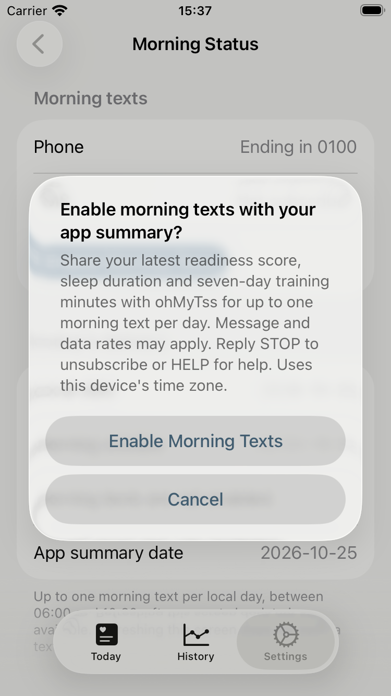
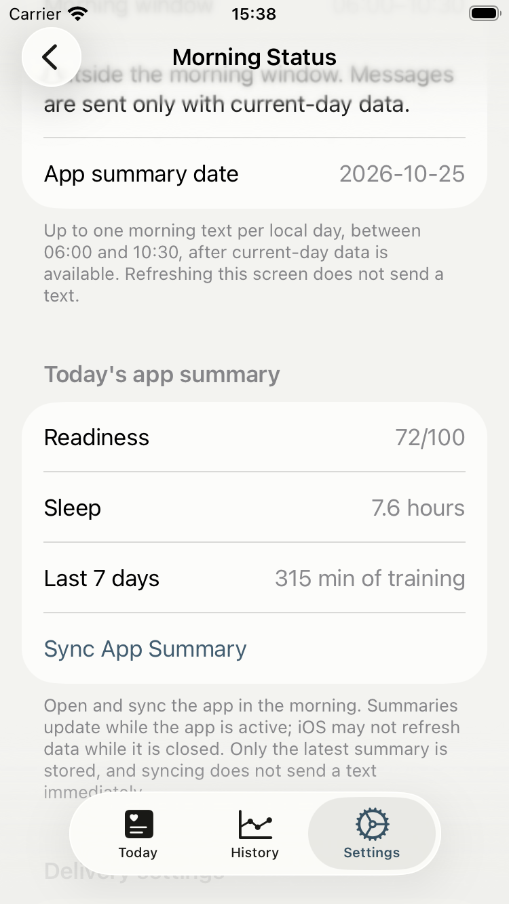
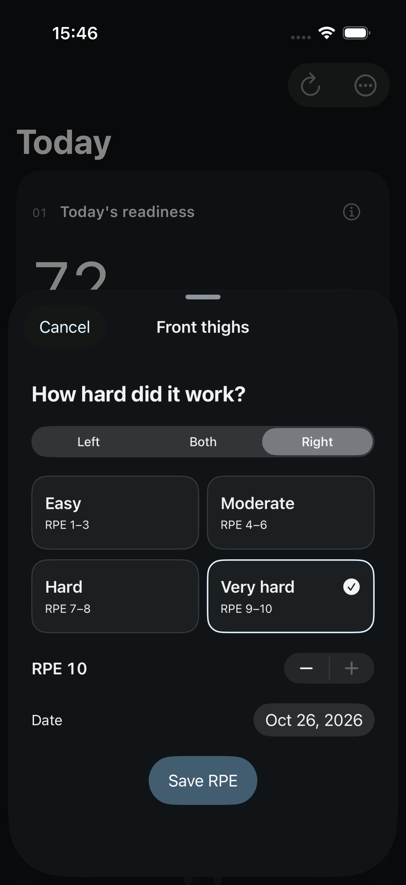

# Morning texts and glass UI validation

Validation date: 2026-10-26. Product: ohMyTss. The private backend remains a
submodule; this repository contains no backend credentials or phone test codes.

## Behavior

- A verified US phone number supports both new users and existing subscribers.
  Verification alone does not subscribe, resume a stopped number, or upload data.
- A separate native confirmation enables morning SMS and sharing of the latest
  readiness score, sleep duration and seven-day training minutes. Raw samples,
  routes and muscle notes remain on the device.
- All active morning delivery uses App summaries. Intervals sync and morning
  reads are disabled. Historical records and SMS consent are preserved.
- Foreground activation and completed local calculations update consented
  summaries. Manual sync remains available. The server retains one summary per
  user and sends at most once per local day, only with current-day data between
  06:00 and 10:30. Uploading does not itself send a message.
- Shared Swiss layouts use native Liquid Glass for controls, restrained
  light/dark colors, and material/opaque accessibility fallbacks.

## Backend evidence

- Private PRs 69 and 70 merged; the submodule pins main
  `fa728283ea1269e5b17a0620fbcb1d6e65eef247`.
- All 392 smoke cases passed locally and in CI. Coverage includes phone
  ownership, strict upload bounds, consent/STOP, current local dates, stale data,
  duplicate delivery and absence of Intervals reads/sync.
- The new App summary table has RLS enabled and no anon/authenticated access.
  Migration checks preserved the existing users and historical training
  records. Database fixture checks ran inside a rolled-back transaction.
- [Exact-main deployment](https://github.com/GodisinHisHeaven/ohmytss-backend/actions/runs/40397242732)
  passed verification, Fly deployment and both health checks. Live privacy text
  confirms App-only morning data.

## iOS evidence

- Xcode 27.1 (27A9275), macOS 27.0.1, iOS 26.4 simulator.
- The final full suite passed on an iPhone SE (3rd generation): **135 executions
  / 132 unique tests**, comprising 113 unit and 22 UI executions, with zero
  failures, skips or runtime warnings. Result bundle:
  `/private/tmp/ohmytss-summary-final-full.xcresult`.
- Final ordinary Release (`ENABLE_TESTABILITY=NO`) passed **all five flows** on
  iPhone 17 Pro / iOS 26.4 with actual dark appearance and Increase Contrast
  enabled: phone entry/privacy without sending SMS, quick RPE, readiness/history,
  maximum-heart-rate save during recalculation, and cold launch. Zero failures,
  skips or runtime warnings. Result bundle:
  `/private/tmp/ohmytss-summary-release-final.xcresult`.
- Five cold launches averaged **1.331 seconds**, relative standard deviation
  2.797%. This measures launch duration, not continuous frame pacing.
- [Retention check](evidence/release-retention.json): all 1,008 workouts and all
  1,000 old estimates were unchanged; recalculation added 1,008 estimates. The
  strength set and seven RPE records were retained; one RPE was intentionally
  edited by the test. SQLite integrity check passed. Simulator appearance was
  restored to light and normal contrast afterward.
- A preceding full run was interrupted when the simulator shut down, terminating
  both the app and UI runner with SIGTERM. Its result is not a passing release
  gate. The interrupted strength create/edit/delete test passed in isolation.
- Earlier UI-only validation passed 128 test executions; optimized Release passed
  five flows with a 1.272-second mean cold launch over five iterations. Final
  summary-feature checks supersede those results for release acceptance.
- No SwiftData schema change is included. Release checks use a persisted synthetic
  store with 1,008 workouts, 1,000 previous load estimates, one strength set and
  seven muscle RPE records. Original records must remain intact after recalculation.

## Live verification and release

Live phone verification and authenticated status retrieval passed against the
deployed backend. Personal verification details, codes and sessions are excluded
from this report.

Xcode Cloud is configured with Build, Test **Required to Pass**, Archive, and
TestFlight Internal Testing. Release delivery is not complete until the merged
main revision passes all actions and its TestFlight post-action.

## Screenshots

Synthetic fixtures; no real athlete health data:

See [shared UI evidence](../ui/evidence/glass-swiss/) for Today, History, RPE,
onboarding, dark appearance and reduced effects.

## Limits

Simulator tests do not establish physical-device frame pacing or guarantee zero
crashes. HealthKit permissions, real Strava changes and delivery receipt on the
user's phone require device validation. iOS does not guarantee fresh summary data
while the App remains closed.
