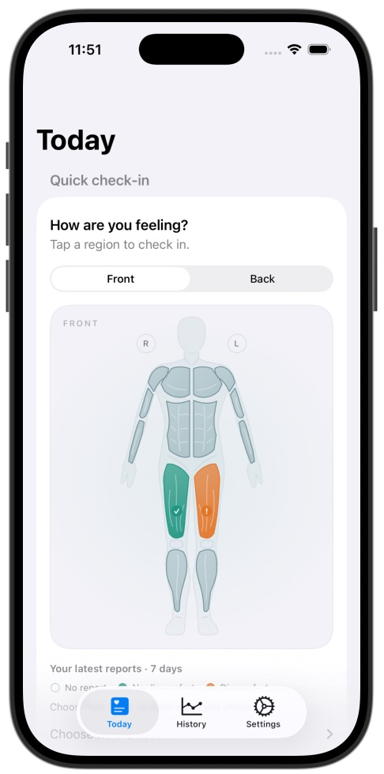
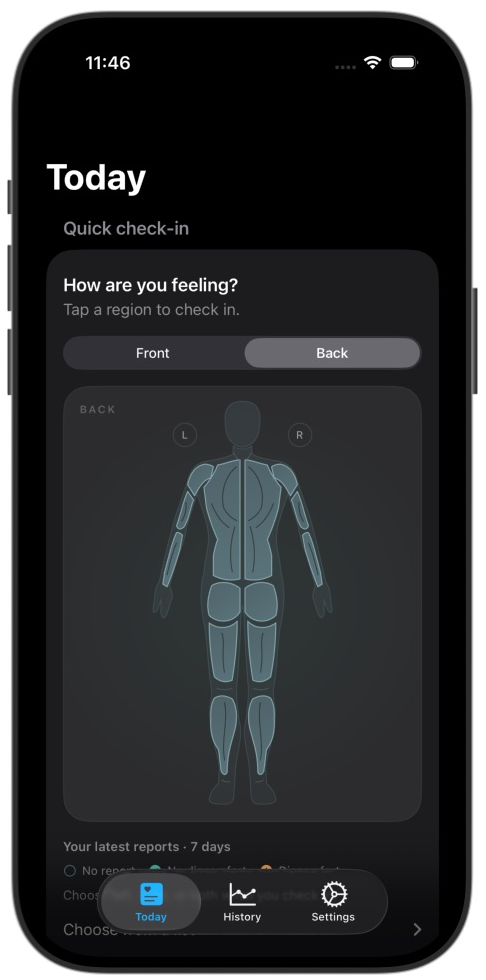

# Body map visual completion — 2026-10-25

Changes validated on `codex/v2-xcode-validation`, based on PR #18 at `8bb4973f6d7860ba4d5f7b54bb10c6e11c0bc26e`, for delivery in that PR. The results below describe local test runs, independently of cloud check status.

## Changes

- Replaced circles and rectangles with a proportioned SwiftUI vector figure. Front and back have separate chest/core, back/glute, thigh and calf shapes, with shoulder and arm contours. The existing nine-region record model is retained.
- Moved the body check-in to the top of Today. Added pressed/selected feedback, left/right orientation labels, a report legend and a list with a minimum 44-point row height.
- Colors represent the latest recorded report for each side in the last seven calendar days: neutral for unreported, teal for explicitly reported no discomfort, orange for discomfort. Check/exclamation symbols accompany the reported states.
- A newer single-side report replaces only that side of an older both-side report. Future and expired reports are excluded; unspecified sides are never painted onto a guessed side. The recording form still asks the person to choose a side explicitly.
- Added light/dark palettes and vertical legend layout at accessibility text sizes. Decorative symbols are hidden from accessibility so a checkmark does not incorrectly mark the region button as selected. Region names, side, report and date remain available in accessibility values. Press animation respects Reduce Motion.

No training-load calculation, physiological recovery prediction, persistence schema or import behavior changed in this visual iteration.

## Verification

Xcode 27.1, iPhone 17 Pro, iOS 26.4.

| Check | Result |
| --- | --- |
| `BodyMapReportsTests` | 6 passed: missing vs none, independent sides, both-side precedence, observed-time window, unspecified side, edit ordering |
| `V2FlowTests` | 4 passed: existing report/strength/skip flows plus the new front/back body-map flow |
| Back region hit targets | All six visible region categories opened their matching recording forms |
| Final decorative-icon accessibility change | Body-map UI flow rerun: 1 passed; native accessibility inspection confirmed no erroneous selected trait |
| Manual visual inspection | Front/back, light/dark, independent left/right colors and compact legend checked in the running app |
| Maximum accessibility text size | Heading wraps; legend stacks vertically; region list expands; Core opens its matching form |
| Final local build and whitespace | Build succeeded; `git diff --check` passed |

The ten-test run finished at 11:43 America/Chicago. After the final decorative-icon accessibility change, the relevant UI flow passed again at 11:51. No failures or skipped tests occurred. This focused validation follows the earlier complete-scheme run documented in `LOCAL_XCODE_2026-10-25.md`; that earlier run applies to its own recorded source hashes.

- `body-map-2026-10-25-summary.json`: ten-test run.
- `body-map-2026-10-25-accessibility-summary.json`: final UI rerun.
- `body-map-2026-10-25-source.json`: final local Swift source hashes.
- Raw logs and xcresult bundles: `/private/tmp/ohmytss-v2-xcode-20261025/body-map-final.*` and `body-map-accessibility.*`.

The manual device was `985C8DEF-3EDF-475A-BDE8-7C832EF7097B`. Its previous light appearance and `large` text size were restored, and the final app was left open on Today. Screenshots contain synthetic test records, not personal health measurements. Images are cropped from Device Hub captures without changing the app contents. Full VoiceOver navigation and physical-device haptics were not assessed in this visual check.

## Screenshots

| Front · light | Back · dark |
| --- | --- |
|  |  |

[Front in dark appearance](body-map/front-dark.png).

## Reproduce

```sh
xcodebuild -project onMyTss/onMyTss.xcodeproj -scheme onMyTss \
  -destination 'platform=iOS Simulator,id=F059EDD5-208C-459F-8B74-8041E362E1D7' \
  -derivedDataPath /private/tmp/ohmytss-v2-xcode-20261025/DerivedData \
  -resultBundlePath /private/tmp/ohmytss-v2-xcode-20261025/body-map-new.xcresult \
  test -only-testing:onMyTssTests/BodyMapReportsTests \
  -only-testing:onMyTssUITests/V2FlowTests -parallel-testing-enabled NO
```
