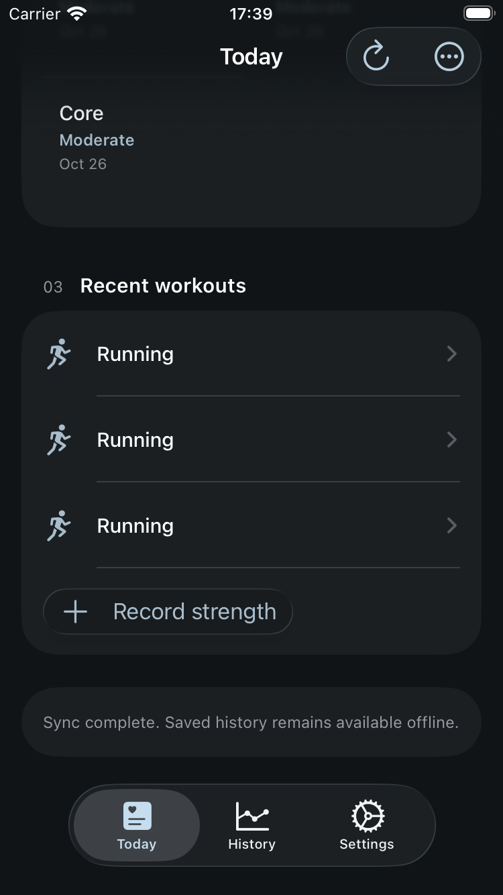
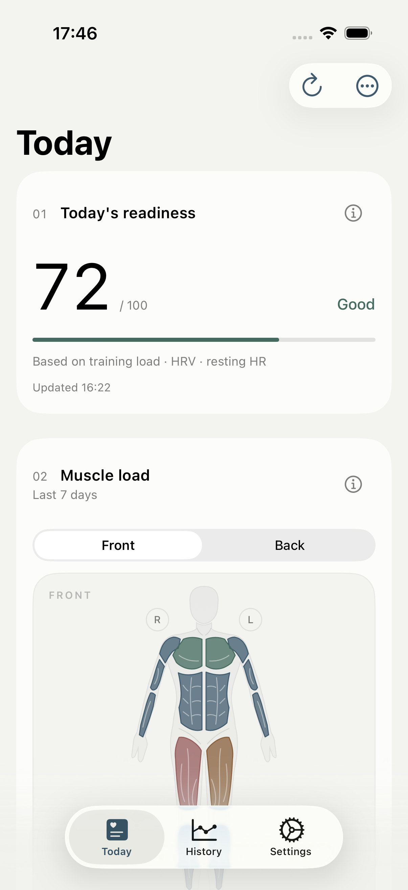

# Incremental activity synchronization — 2026-10-26

Each Sync previously imported 90 days from both sources, then imported the
HealthKit anchor again. Empty deletions still rebuilt history; source
reconciliation compared every pair of activities. Sensor integration and
encoding ran on the UI actor.

HealthKit now uses its persisted anchor directly. Late samples refresh only
the last two days, at most every six hours. Failed sensor reads have a persistent,
rotating retry queue of at most 20 identities per attempt. Source deletions and
corrections can still update older imported activities.

Strava uses the last successful sync with a seven-day overlap, plus a weekly
90-day reconciliation. Initial import remains 90 days; a longer offline gap
extends the range to avoid missing activities. Strava's `after` filter is an
activity start time, not a modification cursor; see the [official activity API](https://developers.strava.com/docs/reference/#api-Activities-getLoggedInAthleteActivities).
Edits to Strava activities older than 90 days fall outside this scheduled
reconciliation. No webhook or backend change is included.

Identical imports do not write models or reconcile sources. Changed imports
commit in batches of 20 with canonical source selection before each commit.
Reconciliation compares adjacent timestamps. Legacy CTL/ATL rebuild starts at
the affected day and carries the dependent tail forward in 14-day batches.
Recovery queries use a separate checkpoint, a three-day correction window and
14 days of baseline samples. Dense sample integration, terrain calculation and
encoding run off the main actor. Threshold changes use saved inputs and restart
derived calculation when a newer setting arrives.

Source cursors advance only after persistence and calculation succeed. A
cancelled partial write retains its recovery marker and resumes without losing
saved activities, manual records or previous estimates. New SwiftData fields
are additive; existing identifiers and the private backend submodule are unchanged.

## Validation

Xcode 27.1 (27A9275), macOS 27.0.1, iOS 26.4 simulators.

- The real SwiftData legacy-to-current migration passed, including default
  values for the new checkpoints and retry queue.
- The complete Debug run passed **154 executions / 151 unique tests** on iPhone
  SE (3rd generation): 130 unit tests and 24 UI executions. The 1,000-workout
  disk scenario imported one activity with 6,000 HR samples in 0.611 seconds,
  repeated sync in 0.176 seconds, with a largest observed main-actor heartbeat
  gap of 0.156 seconds. Old sensor reads and duplicate snapshot writes were zero.
- The same 11 sync regressions also passed under Release optimization
  (`ENABLE_TESTABILITY=YES` for the injected unit-test host, no DEBUG fixtures).
  New-activity sync took 0.549 seconds, repeat sync 0.173 seconds, largest
  observed main-actor heartbeat gap 0.131 seconds. These values measure the
  tested synthetic workload, not production network latency or display frames.
- Ordinary optimized Release (`ENABLE_TESTABILITY=NO`) passed 7/7 UI flows on
  iPhone 17 Pro: sync/navigation, maximum-HR save/navigation, imported muscle
  grades and side adjustment, quick RPE, readiness/History, phone entry without
  sending SMS, and cold launch. Five launches averaged 1.336 seconds (2.158% RSD).
- Release opened the persisted Build 30 synthetic store. All 1,008 workouts,
  1,000 original estimate snapshots, the strength set, original RPE and local
  observation survived. The 1,008 latest estimates use 190 bpm; the only new
  RPE records are the two explicit UI edits. SQLite integrity passed.

The ordinary Release simulator has no HealthKit authorization or Strava account.
Its sync checks cover source-unavailable behavior and usable navigation, not a
live athlete import. Successful imports, repeated sync, weekly reconciliation,
old deletions/corrections, failed-source checkpoints, queued retries,
cancellation/restart and concurrent threshold edits use injected sources with
the real engine and SwiftData. Simulator timings are not physical-device frame
pacing measurements. Physical-device HealthKit/Strava timing remains unverified.

Result bundles are local:

- `/private/tmp/ohmytss-incremental-full.xcresult`
- `/private/tmp/ohmytss-incremental-release.xcresult`
- `/private/tmp/ohmytss-incremental-engine-release.xcresult`

All three result bundles report zero failed tests, skips or runtime warnings.
The optimized unit-test host logged a CoreData framework-version notice for
the preinstalled macOS-created fixture (Persistence-1629 versus iOS
Persistence-1526); it did not report a failed test. The ordinary Release app
opened that store successfully, and its integrity and retention checks passed.

[Full suite](incremental-sync/full-summary.json),
[ordinary Release flows](incremental-sync/release-summary.json),
[optimized engine](incremental-sync/engine-release-summary.json),
[retention](incremental-sync/release-retention.json), and
[migration](incremental-sync/migration.txt) are checked in. Both screenshots
were visually inspected; all records are synthetic.

The cloud workflow remains main-only with Test - iOS Required to Pass and the
existing TestFlight internal group. Cloud results belong to the eventual main
merge commit and are recorded in its PR after Build, Test, Archive and the
TestFlight post-action finish.
