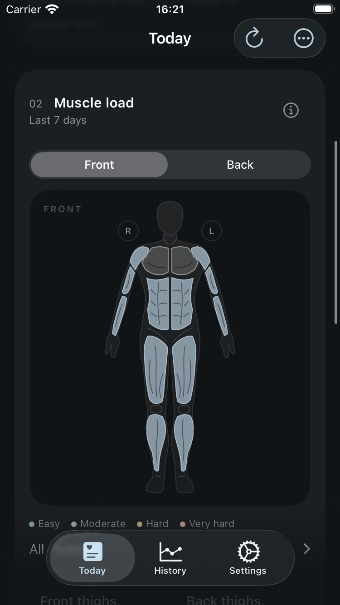
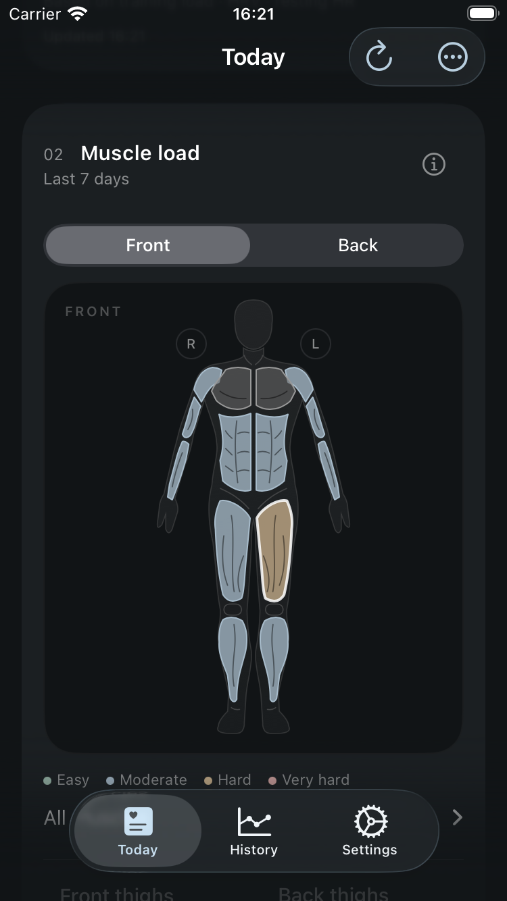
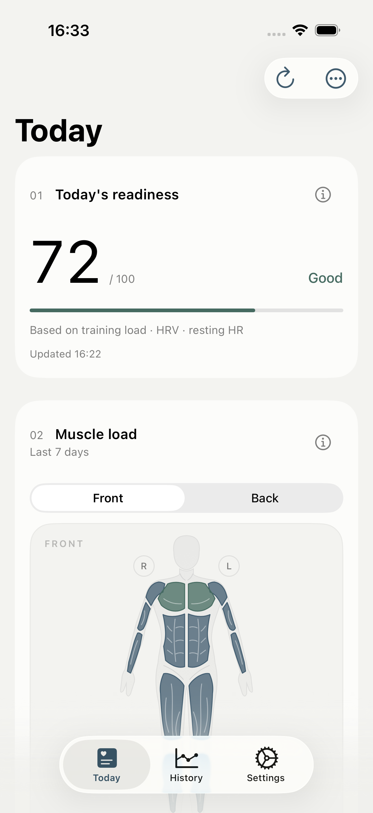
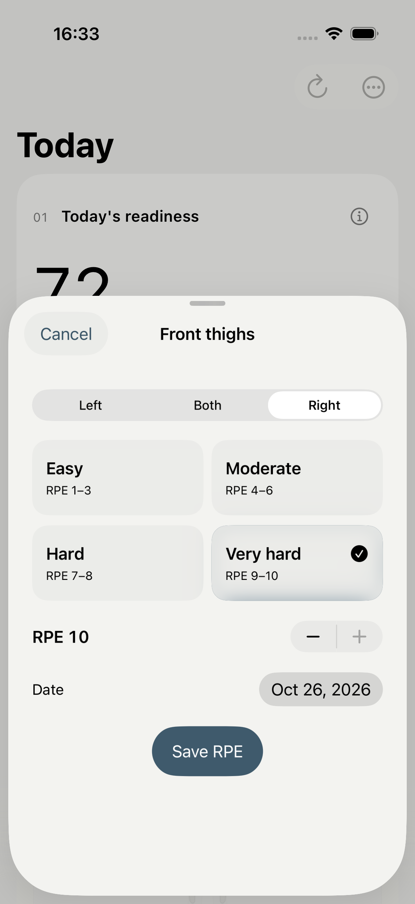

# Muscle map history regression — 2026-10-26

Build 29's dashboard supplied colors only from manual muscle RPE or recorded
strength RIR. Imported endurance workouts could appear in History while the
muscle map stayed gray. The query already supplied seven days of workouts, but
the summary used them only to find the sessions belonging to strength sets.

The summary now consumes those workout records directly. Runs, rides, swims,
walks and known strength exercises supply starting grades; no all-history
backfill, stored estimate decoding, or sensor decoding is required. Records
outside the seven local calendar days, future records, tombstones and suppressed
duplicates remain excluded. For the same timestamp, manual RPE takes priority
over recorded set effort, which takes priority over the workout starting grade.
Each side retains its latest date. Automatic grades never create RPE rows.

The default UI keeps color, grade and date. Source labels, numeric map badges,
the gray-state caption and repeated editor instructions were removed. RPE
numbers remain in the short editor and in accessibility values for recorded
effort. A generic strength import without exercise details cannot identify
specific muscles and remains unassigned.

## Validation

Xcode 27.1 (27A9275), macOS 27.0.1. The focused regression passed 16 tests on
iPhone SE (3rd generation), iOS 26.4, with no failures, skips or runtime warnings.
It checks imported HealthKit/Strava summary fields, malformed sensor bytes that
must not be decoded, local date boundaries, unsupported activity types, invalid
duration, set effort, explicit side overrides, and absence of database writes.
The UI case opens a map with no manual ratings or sets, checks its starting
grade, cancels an edit, then saves one side and verifies both sides after tab
navigation. Both screenshots below were inspected.

The complete unit run passed 119 tests. The existing 1,000-workout disk refresh
test took 2.296 seconds with a maximum observed main-actor gap of 0.123 seconds.
It verifies that the latest threshold wins during overlapping edits, original
records remain intact, and a second refresh does not duplicate snapshots.
Cancellation/restart and concurrent refresh tests also passed.

The final full suite passed **142 executions / 139 unique tests** on iPhone SE
(3rd generation), iOS 26.4: 119 unit tests and 23 UI executions, zero failures,
skips or runtime warnings. It includes dark appearance, accessibility text,
reduced effects, every front/back hit target, strength and discomfort CRUD,
storage retry, large-history launch, maximum-heart-rate save, the native morning
flow and launch performance. Result bundle:
`/private/tmp/ohmytss-muscle-history-full.xcresult`.

Ordinary optimized Release (`ENABLE_TESTABILITY=NO`) passed **6/6 flows** on
iPhone 17 Pro / iOS 26.4 with actual light appearance: history-only lower-body
grades, cancel and one-side override, quick RPE, readiness/History, maximum-HR
save during recalculation, phone entry without sending SMS, and cold launch
(the history flow includes cancel/override). Zero failures, skips or runtime
warnings. Five cold launches averaged **1.290 seconds**, relative standard
deviation 4.425%. Result bundle:
`/private/tmp/ohmytss-muscle-history-release.xcresult`.

The Release app read a preinstalled synthetic store without DEBUG fixture hooks.
[Retention checks](muscle-history/release-retention.json) confirmed all 1,008
workouts, all 1,000 original estimate snapshots, the strength set, preexisting
RPE and discomfort records, and 30 daily aggregates were unchanged. Recalculation
added 1,008 snapshots; every latest snapshot used the saved 190 bpm maximum HR.
The only added RPE records were the two explicit UI edits, retained after cold
launch: left quadriceps 8, right 10. SQLite integrity passed.

Both builds used app/test sources at `102dd592078e3ed0588a74effd08cbad0253c372`;
subsequent validation commits contain evidence only. No test failure was waived.

## Screenshots

Synthetic records only; iPhone SE (3rd generation), dark appearance.

Ordinary Release, light appearance, persisted history:

## Limits

These are simulator measurements, not physical-device frame-rate evidence.
The duration bands are coarse display rules, not individually calibrated
physiological measurements. No persistence schema or backend change is included.
Xcode Cloud Test must remain Required to Pass; exact-main Build, Test, Archive
and TestFlight post-action must pass before delivery is claimed.
