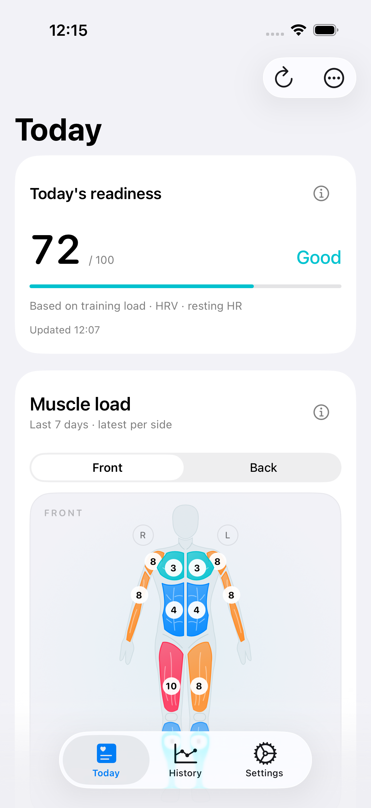
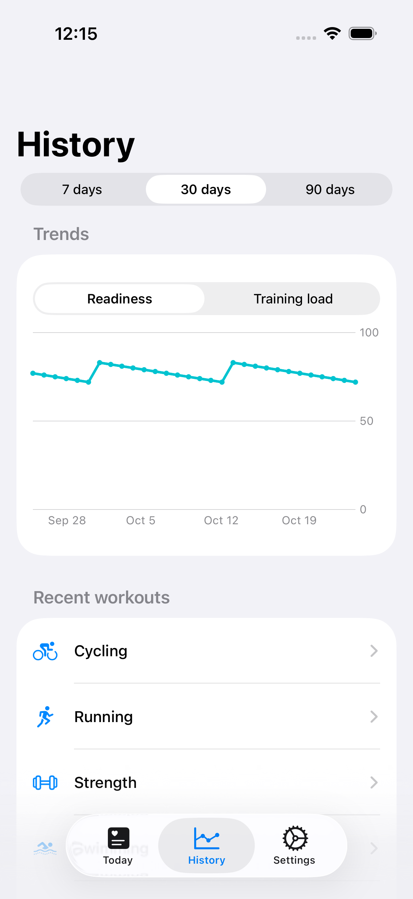
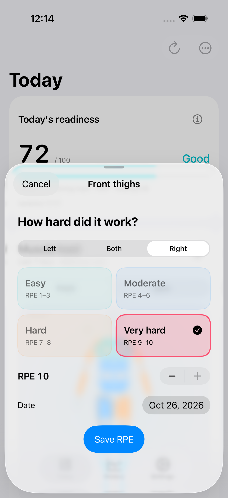

# RPE dashboard and compact History — 2026-10-26

## Product decisions and references

The user selected seven days for the muscle map, quick RPE adjustments instead
of a long form, today's readiness on the home screen, and a History screen with
trends plus category-only workout rows.

- [Fitbod's muscle recovery UI](https://help.fitbod.me/hc/en-us/articles/360006269014-Muscle-Recovery)
  provides a front/back map and direct muscle adjustment. We retained those
  navigation ideas, without adopting its recovery percentages or decay model.
- [Hevy's RPE input](https://help.hevyapp.com/hc/en-us/articles/35687721776663-How-to-Use-RPE-Rate-of-Perceived-Exertion)
  demonstrates compact optional effort selection and the near-failure RIR/RPE
  relationship. We inspected its actual help-page screenshot and used four
  bands plus a one-point stepper, with no keyboard in the primary flow.
- [Bevel's strength RPE](https://help.bevel.health/en/articles/11258753)
  makes inferred effort adjustable; its
  [activity details](https://help.bevel.health/en/articles/14206273)
  put deeper information behind an activity. This informed the short category
  list with retained detail navigation. These are design references, not
  validation of this app's physiological model.

## Implemented behavior

Today shows a saved current-day readiness score with its basis and available
update time. Unknown readiness is explicit. The existing score uses training
load and available HRV/resting-HR baseline modifiers; sleep is context only.

The muscle map reads only today and the preceding six local calendar days.
Each side shows the latest valid RPE, not a weekly sum or historical maximum.
Recorded RIR 0–4 can suggest RPE 10–6 for the exercise's involved regions.
Explicit adjustments override that same-session reference. Missing effort is
gray. The editor preserves the observed date and supports four bands, ±1,
left/both/right, and an optional date change. It does not edit symptom records.

History has one chart switched between readiness and training load, a 7/30/90
day range, and at most six category-only workout rows. Detailed activities and
old discomfort reports remain reachable from Today’s More menu.

`MuscleRPERecord` is an additive SwiftData entity. The dashboard no longer
starts an all-history estimate backfill. It never decodes estimate snapshots
or sensor streams. Existing sync/edit workflows still maintain those records.

## Verification environment

- Xcode 27.1, Swift 6.4; iPhone 17 Pro simulators, iOS 26.1 and 26.4.
- Separate synthetic stores only; no account credentials or personal health
  records were used in the fixture or screenshots.
- `check_v2_migration.sh` passed the original pre-v2 upgrade.
- `check_rpe_migration.sh` passed an actual Build 26 store upgrade, preserving
  workout/TSS, readiness, relationships, symptoms, RIR zero, and byte-identical
  estimate input/payload, then writing the new RPE entity.
- CI configuration: 9 tests passed.

## Final local results

| Run | Configuration and device | Result |
|---|---|---|
| Complete suite | Debug, iPhone 17 Pro / iOS 26.1 | 117 unique tests, 120 executions; 0 failed, 0 skipped |
| Complete unit suite | Optimized Release with test access, iPhone 17 Pro / iOS 26.4 | 102 passed; 0 failed, 0 skipped |
| Persisted UI gate | Normal Release, `ENABLE_TESTABILITY=NO`, iPhone 17 Pro / iOS 26.4 | 4 passed: readiness/History, quick RPE, maximum-heart-rate save, launch performance |

The complete suite includes independent left/right edits, every back-map hit
target, cancellation, retained discomfort CRUD, strength CRUD, storage-open
retry, 1,000-workout navigation, interrupted estimate refresh/restart, and the
native morning-status flow. Unit tests cover the seven-calendar-day boundary,
unknown values, recorded RIR, explicit overrides, unchanged symptoms, disk
reopening, and missing/stale readiness.

After the normal Release UI run, the persisted store still contained all 1,008
workouts with unchanged dates, TSS and sensor bytes, 30 daily records, seven RPE
records and the original symptom. All 1,000 old estimate payload/input bytes
were retained. There were 2,008 total snapshots and 1,008 latest estimates;
every latest input used the saved 190 bpm threshold, and the 1,000 older
workouts each retained all 30 HR intervals. Right-quadriceps RPE changed to 10;
left remained 8 after tab changes and app restarts. SQLite integrity was `ok`.

The 1,000-record responsive-refresh test measured 2.256 seconds / 0.119-second
maximum main-actor gap in Debug and 2.386 seconds / 0.142-second gap in Release.
Normal Release launch duration averaged 1.433 seconds over five XCTest
measurements (1.373–1.467 seconds). These are simulator measurements, not frame
rate or physical-device guarantees.

The first focused UI run exposed two selector assumptions (stepper button
identifiers and lazy List row visibility); both were corrected before the
complete suite passed. Screenshot inspection also caught an oversized-text
date label wrapping vertically. The final layout stacks that label above its
picker and gives large-text effort options full-width rows. A Release run was
canceled during setup because Xcode had shut down its simulator before fixture
installation; the successful run above followed an explicit boot and verified
fixture installation. No failure was waived for release.

Xcode Cloud's Test - iOS action was inspected and remained **Required To Pass**.
The merged commit's Build, Test, Archive and TestFlight post-action must still
be checked in its PR delivery record.

Result bundles are under `/private/tmp/`: `ohmytss-rpe-full.xcresult`,
`ohmytss-rpe-release-unit.xcresult`, and
`ohmytss-rpe-release-verified-ui.xcresult`. Machine-readable counts and retention
checks are in [the evidence summary](rpe-dashboard-2026-10-26-summary.json).

## Inspected screenshots

Actual app screenshots, with synthetic values. Normal Release was verified in
light appearance; Debug was verified in dark appearance and accessibility XXXL
text. Device appearance was set and checked directly for the light run rather
than relying on the launch argument alone. A manual normal-Release scroll also
confirmed that per-region cards display both sides and their observed dates.

| Today | History | Quick RPE |
|---|---|---|
|  |  |  |

[Large-text readiness](rpe-dashboard/today-dark-large.png) ·
[Large-text RPE editor](rpe-dashboard/rpe-dark-large.png)

## Compact-screen cloud regression

Main commit `a059f2a` triggered Cloud Build 27. Build and Archive passed, but
Test passed 116 of 117 unique tests: the back-map test could not reach the
glutes on iPhone SE (3rd generation), iOS 27.0. TestFlight did not run.

The same case failed locally on iPhone SE / iOS 26.4. Its whole-screen swipes
jumped the small target past the visible area. The test helper now uses short
drags with overlapping visible areas in both directions. It still requires
each target to be hittable, taps it, and checks the matching editor title.
Failures now include the target identifier and frame. App code, data models,
and release requirements are unchanged.

The focused reproduction failed before the helper change and passed afterward,
including independent left/right values and all six back regions. The actual
[compact-screen screenshot](rpe-dashboard/back-compact.png) was inspected.
Normal Release (`ENABLE_TESTABILITY=NO`) also passed three changed UI flows on
iPhone 17 Pro / iOS 26.4 with the retained 1,008-workout synthetic store:
readiness/History, quick RPE, and accessibility XXXL controls. No tests were
skipped and the result bundle reported no runtime warnings.

The first attempt to rebuild that normal Release UI run included unit tests,
whose `@testable` imports require a test-enabled app module. The successful
run built only the UI-test target and normal app, then used
`test-without-building`. The complete Release unit suite above used the
separate test-enabled configuration as intended.

Result bundles: `/private/tmp/ohmytss-rpe-compact-repro.xcresult`,
`ohmytss-rpe-compact-fixed.xcresult`, and
`ohmytss-rpe-release-scroll-verified.xcresult`. The follow-up PR records the
complete compact-device suite and the next exact-commit Cloud delivery.

## Reproducing the persisted Release fixture

`ReleaseDashboardSeed.swift` is an external macOS tool; it is not in the iOS
target. It refuses to overwrite an existing destination. Compile it with the
current `Models/*.swift`, `Domain/*.swift`, and the DEBUG-only
`Utilities/LaunchHistoryFixture.swift`, using `swiftc -D DEBUG -module-name
onMyTss`. Its new store contains 1,008 synthetic workouts, 30 heart-rate
intervals on each of 1,000 older workouts, 1,000 original snapshots, 30 daily
aggregates, seven RPE ratings, one strength set, and one discomfort report.

Install a normal Release build (`ENABLE_TESTABILITY=NO`) into an isolated
simulator and copy this fixture into its stopped app's data container. Back up
any previous synthetic store first; never replace an unverified user store.
The Release app contains no fixture launch flags. Run the existing readiness,
History, quick-RPE, large-text, maximum-heart-rate, and launch-performance UI
tests against that persisted store, then inspect preservation and new snapshots.

## Limits

Simulator timings and synthetic data do not establish physical-device frame
rates, real HealthKit permission behavior, or Strava OAuth success. No claim of
zero possible crashes is made. Full VoiceOver navigation needs device testing;
the automated suite checks accessible labels, values, and reachable controls.
